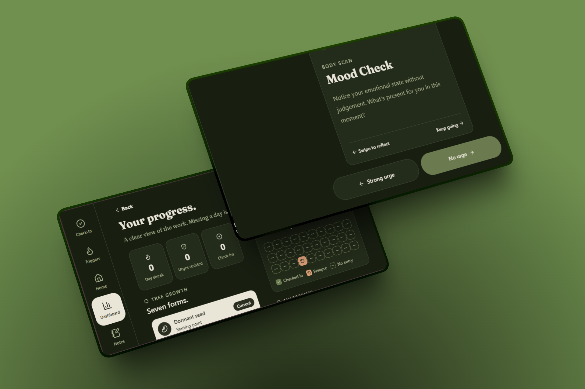
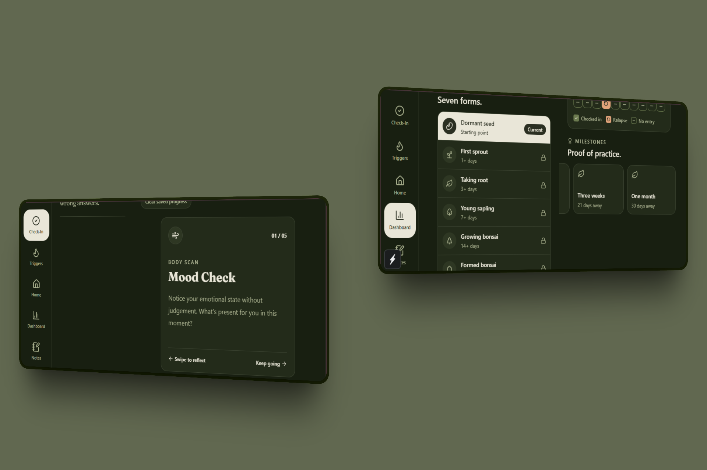

# Habitat

A calm habit-change companion built with Expo and React Native. Pick a habit to break, check in daily, log triggers, and watch your streak grow a virtual bonsai.

[Demo video](https://drive.google.com/drive/folders/1DpvFGlGrIhNJou3QP8Las2hfHzAL_lSD?usp=sharing)

## Mockups





## Features

- **Auth and onboarding**: Email/password sign-up and sign-in (Firebase Auth), then choose the habit to change.
- **Daily check-in**: A swipeable four-card reflection. If a relapse is logged, a final card asks about the trigger and takes an optional note.
- **Bonsai**: Your current streak sets how far the bonsai has grown.
- **Trigger log**: Create, view and delete triggers, with intensity and relapse flags.
- **Notes**: Notes from check-ins and relapse follow-ups in one list.
- **Dashboard**: Streak, urges resisted, check-ins, a 30-day consistency map, growth stages and milestones.
- **Daily quote**: Fetched from ZenQuotes, with a local fallback.
- **Layout**: Bottom tabs in portrait, a side rail in landscape.

## Tech

Expo SDK 58 · React Native 0.88 · React 19 · Expo Router · NativeWind · Firebase Auth and Firestore · Lucide icons · Fraunces font

## Structure

```text
frontend/
  app/            Routes: splash, auth, onboarding, and (tabs)/ for the main screens
  components/     Screens, cards, headers, modals and controls
  functions/      Firebase access: auth, users, triggers, swipes (check-ins), progress, quotes
  lib/            Navigation helpers and the dev clock
  constants/      Colour and type tokens
  assets/         Images, including mockups/
backend/          Empty; reserved for future server work
```

## Data model

All data is scoped to the signed-in user:

```text
users/{uid}
users/{uid}/addiction_record/{recordId}
users/{uid}/addiction_record/{recordId}/triggerLog/{triggerId}
users/{uid}/check_in_record/{checkInId}
users/{uid}/plant_state/current
```

Progress is calculated from check-ins and trigger logs in `frontend/functions/progress`. `plant_state/current` only caches the result and is not the source of truth.

## Setup

You need Node.js 20+, npm, and a Firebase project with Authentication (email/password) and Firestore enabled.

```bash
cd frontend
npm install
cp .env.example .env     # on Windows: copy .env.example .env
```

Fill `frontend/.env` from Firebase Console under **Project settings > Your apps > Web app**:

```env
EXPO_PUBLIC_FIREBASE_API_KEY=
EXPO_PUBLIC_FIREBASE_AUTH_DOMAIN=
EXPO_PUBLIC_FIREBASE_PROJECT_ID=
EXPO_PUBLIC_FIREBASE_STORAGE_BUCKET=
EXPO_PUBLIC_FIREBASE_MESSAGING_SENDER_ID=
EXPO_PUBLIC_FIREBASE_APP_ID=
EXPO_PUBLIC_FIREBASE_MEASUREMENT_ID=
```

Google sign-in is currently switched off. If you re-enable it, also set the `EXPO_PUBLIC_GOOGLE_*_CLIENT_ID` variables from `.env.example`.

Add Firestore rules that let a user read and write only their own `users/{uid}` data. Never commit `.env`.

## Run

From `frontend/`:

```bash
npm start          # then press a (Android), i (iOS) or w (web)
npm run android
npm run ios
npm run web
```

The app opens on a splash screen, then goes to sign-up. Signed-in users go straight to Home.

## Developer tools

Development builds show a **Time travel** panel at the bottom of Home, Dashboard and Check-In. Switch it on and step through days; the whole app, including anything you save, uses the simulated date. With it on, Check-In also offers **Complete this day** and **Clear all check-ins**.

These tools write to the real Firestore data of the signed-in account, and **Clear all check-ins** deletes every check-in. They never appear in production builds, and time travel resets when the app reloads.

## Checks

```bash
npx tsc --noEmit
npm run lint
```

## Contributing

Branch from `main`, keep changes focused, run both checks, and describe any user-facing or Firestore schema changes in the PR.

## License

MIT.

<div align="center">
Made with 🌱 by Keabetswe Olifant
</div>
